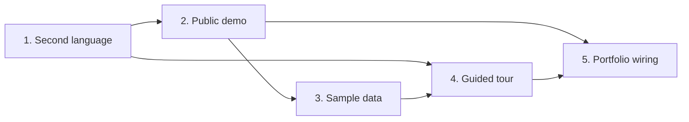

# Playbook: second language, public demo, sample data and guided tour

A guide for an agent adding these four features to **another app**. It's distilled from Memo (tickets 20 to 23, decisions 18 to 21), but written to be app-agnostic: what to decide with the user, the mechanisms that worked, the order, the tests, and the traps we hit. Memo specifics (SvelteKit, Drizzle on Neon, Lucia, Vercel) appear only as examples; swap in the target app's equivalents.

## How to use it

1. Read the target app first: auth, database access, outbound integrations (messaging, calendar, email, storage), deployment, and how it's tested.
2. Settle the open questions in each section with the user, **one at a time**, recommending an option each time.
3. Write the decisions and one ticket per feature, then build in the order below, one feature per ticket, verifying each before the next.
4. Treat every outward step (creating databases or projects, migrations, production deploys) as needing the user's explicit go, shown before it runs.

Language goes first so every later screen, the demo copy and the tour are written in both languages once instead of retrofitted. The tour comes after sample data because in the demo it points at real appointments.

## Ground rules that held up

- **The real database never meets anonymous visitors.** The demo is a separate deployment on its own empty database.
- **Avoid production migrations when a design can do without them.** All four features shipped with zero schema changes to production: demo accounts are recognized by a reserved email domain and aged by an existing `created_at`; the tour is remembered by not needing to be remembered.
- **Simulate outbound effects at the lowest layer** (the function that would call the external API), not at each call site.
- **Secrets never pass through the conversation or docs.** Pipe them from private files into the platform's env store; deploy from a clean export so local env files never upload.
- **Verify live.** Every feature here had a bug that only the deployed, end-to-end run found.

---

## 1. Second language (full interface translation)

### Decide with the user

| Question                                   | What we chose                                                                                                                     | Why                                                                               |
| ------------------------------------------ | --------------------------------------------------------------------------------------------------------------------------------- | --------------------------------------------------------------------------------- |
| How is the language picked the first time? | The browser's `Accept-Language`, then a switch that overrides and is saved                                                        | No extra step for anyone; the switch fixes the rare wrong guess                   |
| Where does the switch live?                | Account menu, login page, and Settings                                                                                            | Login covers signed-out visitors; Settings is where people look                   |
| Where is the choice stored?                | On the user row if one exists (follows them across devices), plus a cookie for signed-out pages                                   | Memo already had an unused `language` column; check the target app's schema first |
| What is **not** translated?                | Messages to the business's own customers (WhatsApp, calendar invites) and words the user typed (their client term, service names) | Those belong to the business, not the viewer                                      |

### Mechanism

- **A compiled i18n library** that ships only the messages a page uses (Memo: Paraglide JS). Avoid runtime parsers for performance.
- **Resolution order on the server, per request:** saved user language, then cookie, then `Accept-Language`, then the base language. Keep the cookie in step with the saved choice so client-side code reads the same answer.
- **`<html lang>` and the meta description** set from the resolved language (replace placeholders in the HTML shell).
- **A switch endpoint** (`POST /api/language`) that saves on the signed-in user's own row (never an impersonated business) and sets the cookie; the client reloads.
- **Dates per language as patterns, not translations of one pattern.** A small table such as `es: "EEEE d 'de' MMMM"` / `en: "EEEE, MMMM d"` keeps the base language byte-for-byte identical and makes the second one read naturally. Day names from `Intl.DateTimeFormat(locale, { weekday })`.
- **Calendar libraries:** load the locale file only for languages that need one; keep explicit settings such as week start, which a locale may silently change.
- **New accounts inherit the language they signed up in.**
- **Onboarding offers defaults in the owner's language** (e.g. "client / patient / student / guest"), stored as chosen and never translated afterwards.

### Build it in passes, each deployed and checked

1. Setup, detection, the switch, the app shell (menus, account menu, login).
2. The busiest screen (Memo: calendar plus its modals and notifications).
3. The next area (Memo: clients, trash, profile, payments).
4. Settings and onboarding.
5. Admin, error pages, leftovers, then the scan below.

### Finish with a mechanical check, not a read-through

- Scan every component for literal text nodes and text attributes (`placeholder`, `aria-label`, `title`, `alt`, label props) outside the message files; only brand names should remain.
- Check that both message files have the same keys, matching `{parameters}`, no unused keys, and no values identical in both languages.
- Grep for literal notification titles (`title: '...'`).
- Screens that only appear on error (404 pages, failed saves) are easy to miss; translate their messages on the server.

### Traps we hit

- **The library's build plugin crashed the build** (a segfault under Node 24). Compiling with its CLI before `dev`, `build`, `test` and `check` worked the same; git-ignore the generated output.
- **Longer strings break small layouts.** "Create appointment" wrapped at 390px; the English label became "Book". Run an overflow sweep of every page at 320 and 390px in the new language.
- **A silent failure surfaced:** a failed booking only logged to the console. Translating notifications is a good moment to check each failure path tells the user.
- **Unrelated layout bug found while screenshotting:** a CSS rule outside the framework's layers beat a `hidden` utility, so the phone bar showed on desktop. Screenshots at several widths in both languages catch this kind of thing.
- **Bundle growth:** about 6% gzipped for two languages plus date locales. Measure before and after.

---

## 2. Public demo (try it without an account)

### Decide with the user

| Question                                            | Options                                                                                         | What we chose                                                                                                                               |
| --------------------------------------------------- | ----------------------------------------------------------------------------------------------- | ------------------------------------------------------------------------------------------------------------------------------------------- |
| Where does the demo run?                            | A separate deployment on its own database; a demo mode inside production; one shared demo login | **Separate deployment and database.** Anonymous code paths never sit next to real records, and one scoping bug can't expose a real business |
| What gets simulated?                                | Each outbound effect                                                                            | Messaging logged as simulated, calendar sync replaced by sample "busy" blocks, uploads off                                                  |
| How long does a demo live?                          | Hours to days                                                                                   | 48 hours, then deleted by the existing daily job                                                                                            |
| Does the demo keep Google (or other OAuth) sign-in? | Yes or no                                                                                       | No: the demo leads with the account-free button only                                                                                        |

### Mechanism (code)

- **One environment switch** (`DEMO_MODE=on`) read on the server. Production never sets it, so none of the demo code runs there. Put the flag in a tiny module with no database import, so low-level modules (like the messaging client) can check it and their unit tests stay database-free.
- **Anonymous account:** a `POST /auth/demo` endpoint (POST only, so link preloading on hover can never create accounts) creates a user with a placeholder email on a **reserved domain** (`demo-<id>@demo.invalid`; `.invalid` can never be real), opens a normal session and sends the visitor into the **real onboarding**. Recognizing demo accounts by that domain and aging them by `users.created_at` means **no new column and no production migration**.
- **Abuse limits, two layers:** a per-IP count in the function instance's memory (best effort; serverless instances come and go) and a hard cap on demo accounts per hour counted in the database. If already signed in, carry on instead of minting another account.
- **Simulations at the lowest layer:**
  - The messaging send function returns `{ simulated: true }` in the demo **before any credential check**, even if credentials are present. Callers that record delivery mark it `simulated`.
  - Where calendar busy time would load, return a few stand-in blocks in the business's time zone.
  - Uploads: refuse on the server, and show "uploads are off in the demo" where the upload button would be.
- **A banner** in the app shell stating what's deleted and what's simulated (short and long versions for phone and desktop).
- **Purge:** extend the existing daily cleanup job to delete demo accounts older than the TTL with every dependent row, in foreign-key order (reminders, files, payments, appointments, clients, hours, sessions, user). Re-check inside the delete that the account really is a demo one.
- **Hide demo accounts from admin views.**
- **Hide meaningless details:** greet a demo visitor without a name; show "Demo account" instead of the placeholder address.
- **Make OAuth keys optional at runtime.** Static imports of secrets fail the build when the demo has none; read them dynamically and hide the sign-in option when they're absent.

### Infrastructure (each step shown to the user and confirmed)

1. **A new, empty database.** Not a plain branch of production: database branches copy data. A schema-only branch also works.
2. **Migrations on the demo database only,** using a separate config file that names only the demo connection and never loads local env files. First confirm the target host is the demo's and that it has no tables.
3. **A second hosting project** with the demo's env: database URL (sensitive), `DEMO_MODE=on`, a newly generated cron secret (sensitive), the public URL. No messaging, storage or OAuth keys.
4. **Deploy from a clean export** (`git archive <commit>` into an empty folder) and target the project with env variables (`VERCEL_ORG_ID`, `VERCEL_PROJECT_ID`), so the repo's existing link to the production project is never rewritten and local env files never upload. Don't connect it to Git unless the user wants automatic deploys.

### Tests

- Unit tests for the switch, the account check, the stand-in blocks in two time zones, and both limits.
- **The purge against a real Postgres in memory** (PGlite) with the app's actual migrations applied: an old demo business is removed whole, a young demo and an old real business are untouched.
- The messaging client in demo mode makes **no network request** even with credentials set.
- Live, in a clean browser: account-free sign-in, onboarding, banner, stand-in blocks, a booking (check the function log says the message was simulated), uploads refused, no page errors, and the demo database holds only demo accounts.

### Traps we hit

- **A local dev server kept running with real credentials.** The kill pattern (`vite dev`) didn't match the process (`vite.js dev`), so a server from an earlier run served later runs and reloaded with `.env.local` after it was restored. Check that it's really gone (`pgrep`) every time, and never point local tests at production.
- **Importing the database client into a low-level module broke its unit tests** until the flag moved to its own module.
- **Static secret imports** made a key-less deployment fail to build (see above).

---

## 3. Sample data for the demo

### Decide with the user

Offered after onboarding (recommended), always loaded, or never. We chose **offered**: a card on the empty calendar, "Fill with sample data" or "Start empty".

### Mechanism

- **An endpoint** that only works in the demo, only for demo accounts, not while impersonating, and only into a business with **no clients yet** (409 otherwise), so it can't double up or touch the visitor's own data.
- **The seed** (Memo: 8 clients, 12 appointments, 5 payments, notes, quick services):
  - Content in the **owner's language**, with neutral names and example-domain emails and test phone ranges.
  - Times **relative to now in the business's time zone**, from a few days back to a few ahead, so the week always looks current. Convert wall times with `Intl`, not the server's zone.
  - Cover **every state the UI shows**: past, in progress (clamped inside the visible hours), upcoming, cancelled, invited. If a state depends on an external link (Memo's "Invited" needs a calendar event id), set a placeholder id; there's no real event behind it.
  - Fill related settings that make the app look used (Memo: the quick-service shortcuts) only when they're empty.
- **The card** shows when the account is a demo one and the business has no appointments and no clients. "Start empty" is remembered in browser storage (the demo lives in one browser anyway); once filled, the card no longer qualifies.

### Tests and traps

- Test the seed on the in-memory Postgres against a fixed "now": counts, each state present, exact local times, both languages, and that the purge removes a seeded business whole.
- **A hydration bug only the live run found:** tapping onboarding's submit before the page's script ran submitted the form natively (a GET), reloading the page and losing what was typed. Keep such buttons disabled until the page is ready. It affected every new user, not just the demo.
- Check what the UI actually loads: Memo's calendar only loads active appointments, so the cancelled sample shows in the client's history, not on the calendar.

---

## 4. Guided tour

### Decide with the user

| Question                | What we chose                                                                        |
| ----------------------- | ------------------------------------------------------------------------------------ |
| Scope                   | A short core tour, about five steps, plus welcome and done cards                     |
| Interactive or narrated | Mixed: narrated with "Next" always available; the creation step invites a real tap   |
| Who sees it             | Every new business once, right after onboarding, demo and real; replay from Settings |
| Library                 | driver.js (spotlight, positioning, keyboard, about 5 KB), restyled and lazy-loaded   |

### Remembering completion without storage

Onboarding redirects to the main page with a one-time `?tour=1`. The page queues the tour on that arrival and immediately removes the flag from the address. Onboarding happens once per business, so the tour shows once; reloads and other devices never see it again; Settings links to the same `?tour=1` to replay. No column, no migration. The only gap: closing the browser mid-tour doesn't re-offer it (Settings still does). If the app needs strict "seen" tracking across devices, add a per-user timestamp instead.

### Mechanism

- **Load the tour module and the library only when a tour starts** (dynamic import of both the JS and its CSS); nothing in the normal bundle.
- **Anchors per layout:** for each step, pick the first matching element that's actually on screen (`getBoundingClientRect` width and height above 0), so one step list covers the desktop side menu and the phone bar. Steps with no element render as centered cards. Wait for asynchronously mounted components (a calendar) before starting.
- **The hands-on step:** on highlight, listen once for a click on the highlighted element; on click, mark the tour as paused, destroy it after the click is handled (so the link still navigates), and let the page resume at the next step when the form it opened closes. Add a timeout fallback in case the form never opens. Don't report "ended" when destroying for this pause.
- **Order with other first-run UI:** in the demo the tour waits until the sample-data card is answered, and it never starts while a modal is open.
- **Copy per input type:** "Tap +" and "press and hold" on touch, "click" and "drag" with a mouse.
- **Accessibility:** arrow keys, Escape to leave, overlay clicks ignored (leaving is explicit), focus visible on buttons, no animation with reduced motion.
- **Theme** the popover with the app's tokens (surface, radius, pill buttons, primary color for "Next"), in both light and dark.

### Tests and traps

- **A frozen test clock stalls the library's animation,** so the spotlight cutout never moves and the overlay swallows clicks on the highlighted element. Run tour tests with reduced motion in such harnesses, and do one live run with animation on.
- Off-screen test helpers fail to click on full-height layouts; trigger them from script.
- Test: the full walk on phone and desktop in each language, the hands-on step (form opens, tour hides, resumes on close), Skip, Escape, replay from Settings, that the library isn't requested before the tour, and no overflow. Live: a new demo visitor on a touch device through onboarding, sample data and the tour, then a reload that doesn't bring it back.

---

## 5. Portfolio wiring (Memo's next step, not yet built)

- A short intro on the demo's login page in both languages: what the app is, what to try, what's simulated, with the account-free button as the main action.
- The English link preview (Open Graph) for the demo URL.
- A "Try it" section in the README linking the demo.
- The user adds the link to their portfolio.

---

## Verification matrix to reuse

| Check                                                                                             | Where                                                                          |
| ------------------------------------------------------------------------------------------------- | ------------------------------------------------------------------------------ |
| Type check, unit tests, build                                                                     | Every commit                                                                   |
| Purge and seed against real migrations                                                            | In-memory Postgres (PGlite)                                                    |
| Every page in both languages and both themes, at 320, 390 and 1280px, with no horizontal overflow | Headless browser against a dev server with no real database (mocked page data) |
| Demo flow end to end, function logs, database contents (read-only)                                | The deployed demo, clean browser                                               |
| Production preview unchanged where the demo switch is off (no demo button, sign-in intact)        | The deployed preview                                                           |

## A brief to hand another agent

> Add a second interface language, a public demo with its own database, demo sample data and a guided tour to &lt;app&gt;, following the playbook at `artifacts/feature-playbook`. Read the app first, then settle each section's questions with me one at a time, recommending an option. Write the decisions and one ticket per feature, and build them in the playbook's order, deploying a preview after each pass. Never connect to or write the production database, avoid production migrations where the playbook shows a way around them, and show me every outward step (new databases or projects, migrations, deploys) before running it.

